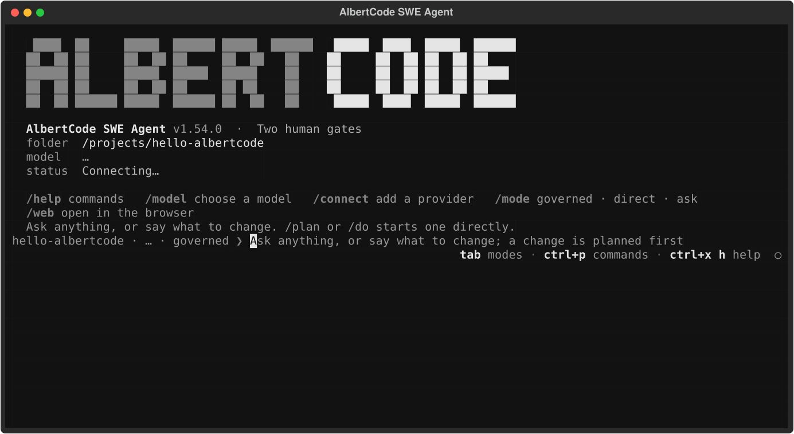

<div align="center">


# AlbertCode SWE Agent

### The coding agent that proves its work.

Plan, build, test and review changes across your codebase.<br>
Work in your terminal, browser or VS Code. Choose your own model.

[**Get started**](#quick-start) · [Documentation](docs/README.md) · [Latest release](https://github.com/huynvic/albertcode-swe-agent/releases/latest) · [Community](https://github.com/huynvic/albertcode-swe-agent/discussions)


</div>

> **New in 1.54.0:** A redesigned browser workspace, a full-screen terminal, and shared sessions across both. [Read the release notes →](https://github.com/huynvic/albertcode-swe-agent/releases/tag/v1.54.0)

## Your workflow. Your model. Your decision.

AlbertCode runs on your computer and works with your existing repositories. In **Governed** mode, it proposes a plan, builds in an isolated copy, runs your project's checks and reviews the result. You approve the plan and accept the final diff before the change reaches your working tree.

| Review the change | Work where you want | Connect your tools |
| :--- | :--- | :--- |
| Plans, diffs, tests and reviews stay together with each task. | A full-screen terminal, browser workspace and VS Code extension use the same local service. | Hosted or local models, MCP servers and a gallery of 88 connectors. |

## Quick start

### 1. Install

**macOS and Linux**

```bash
curl -fsSL https://raw.githubusercontent.com/huynvic/albertcode-swe-agent/main/installer/install.sh | sh
```

**Windows · PowerShell**

```powershell
irm https://raw.githubusercontent.com/huynvic/albertcode-swe-agent/main/installer/install.ps1 | iex
```

The installer selects your build, verifies its checksum and asks before installing. It includes the Python runtime. Open a **new terminal** when it finishes.

[Download an installer instead →](https://github.com/huynvic/albertcode-swe-agent/releases/latest) · [Installation guide and requirements →](docs/installation.md)

### 2. Open your project

```bash
cd your-project
albertcode
```

Prefer the browser? Run `albertcode web`. For VS Code, install the `.vsix` from the [latest release](https://github.com/huynvic/albertcode-swe-agent/releases/latest) after installing AlbertCode.

### 3. Connect a model and make a request

Use `/connect` to add a provider or local model server. Then describe the change:

```text
The login endpoint returns 500 when the password is empty.
Fix it and add a regression test.
```

In Governed mode, **approve the plan → review the diff and evidence → accept the change**.

[Complete your first task →](docs/getting-started.md)

## One agent. Three interfaces.

### Terminal

A full-screen workspace for sessions, conversations, approval gates and commands. Open the command palette with **Ctrl P**, switch modes with **Tab**, and choose from six additional themes. `albertcode classic` retains the earlier terminal interface.



<sub>Terminal interface from the released 1.54.0 package, rendered in an offline UI harness. No model is connected and no task results are shown.</sub>

[Terminal guide →](docs/terminal.md)

### Browser workspace

Keep the conversation beside the Changes, Files, App, Tests, Context and Task inspector. Group sessions by project, open commands with **Ctrl K**, and dock a terminal beneath the conversation.

The browser and terminal share sessions. Start in one and continue in the other.

[Browser guide →](docs/browser.md)

### VS Code

Work from the AlbertCode panel in your editor, using the same local service and approval workflow.

[VS Code guide →](docs/vscode.md)

## From request to reviewed change

| Step | What happens in Governed mode |
| :--- | :--- |
| **Plan** | AlbertCode examines the repository and proposes the work. You approve the plan. |
| **Build** | The change is implemented in an isolated copy of your repository. |
| **Verify** | Your project's checks run, with reviews and results attached to the task. |
| **Review** | Inspect the diff and its evidence. Accept or discard the change. |

Need a different pace? **Direct** works in your files with approval before each write, or auto-approval when selected. **Ask only** explores the repository without starting changes. [Compare the modes →](docs/how-it-works.md#modes)

## A workspace for the whole task

| Capability | What you can do |
| :--- | :--- |
| **App preview and visual editing** | Run your app beside the chat, inspect different widths and review code changes from visual edits. |
| **Browser tests** | Create and run Playwright tests, inspect failures and start a fix with the failure context. |
| **Requirements** | Track a specification against linked tasks and test evidence. |
| **Architecture** | Explore components and connections identified from your repository's files. |
| **Tasks and evidence** | Track progress on a board, inspect approvals and export the task record. |
| **MCP and connectors** | Connect local or remote servers, including services that require sign-in. |
| **Commands, agents and plugins** | Extend workflows with project commands, custom agents, skills and plugins. |

[Explore the documentation →](docs/README.md)

## Choose your model

Connect a hosted provider, OpenRouter, Hugging Face, a compatible API endpoint, or a local server such as Ollama, LM Studio or vLLM. The model must support tool calling; capability and results depend on the model you choose.

Use your own provider account or local model. [Model setup →](docs/models.md)

## Local by default

AlbertCode runs on your computer, with **no AlbertCode account and no telemetry**. Hosted models receive the code and context needed for your requests; connected tools use the services you configure. Local model inference can stay on your machine.

Saved keys use your operating system's protection. Governed mode keeps the proposed change isolated until you accept it; Direct mode writes to your working tree.

[Security model](docs/security.md) · [Privacy](PRIVACY.md) · [Report a vulnerability](SECURITY.md)

## Benchmark evidence

**39 / 51 tasks resolved on SWE-bench Pro HARD-51 · 76.5%**

This is a **self-reported historical evaluation**, not an independently verified result or a new evaluation of version 1.54.0. The report describes a frontier hosted model, one attempt per task, up to 50 minutes per task and no human intervention. The held-out subset resolved **14 / 22** tasks.

[Read the methodology, per-task outcomes and limitations →](benchmarks/results/swe-bench-pro-hard51-2026-09-frontier-model/REPORT.md)

## Update and support

**Update:** Run the installation command again. Saved model keys are cleared on upgrade; reconnect with `/connect`.

**Uninstall:** Run `albertcode uninstall`. It asks first and keeps settings unless you select their removal.

The downloadable installers are currently unsigned. See the [installation guide](docs/installation.md#unsigned-installers) for Windows SmartScreen and macOS Gatekeeper instructions.

| Help | Link |
| :--- | :--- |
| Start here | [Getting started](docs/getting-started.md) · [Troubleshooting](docs/troubleshooting.md) · [FAQ](docs/faq.md) |
| Product updates | [Releases](https://github.com/huynvic/albertcode-swe-agent/releases) · [Changelog](CHANGELOG.md) · [Roadmap](ROADMAP.md) |
| Community | [Discussions](https://github.com/huynvic/albertcode-swe-agent/discussions) · [Report an issue](https://github.com/huynvic/albertcode-swe-agent/issues/new/choose) |
| Contribute | [Contribution guide](CONTRIBUTING.md) |

## License

**AlbertCode SWE Agent is proprietary software.** This public repository contains documentation, installers, examples and benchmark methodology. Repository code is [Apache-2.0](LICENSE); documentation is [CC BY 4.0](https://creativecommons.org/licenses/by/4.0/). See [licensing](LICENSING.md).

<div align="center">

Built by Huy Nguyen · If AlbertCode helps your work, star the repository.

</div>
